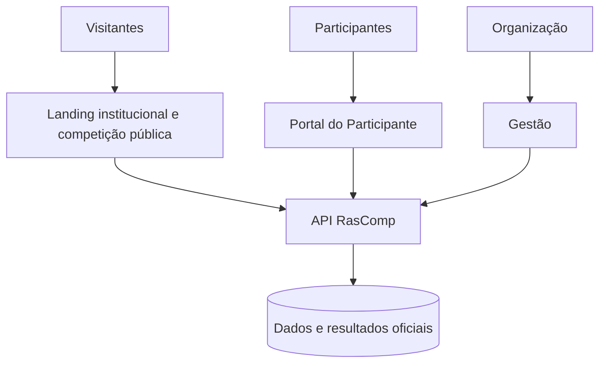

<div align="center">
  

  # RasComp — Interfaces Web

  **A experiência pública, administrativa e do participante para competições de robótica.**

  Projeto desenvolvido no contexto da **IEEE Robotics & Automation Society — UFRB**.

  [🌐 Conhecer o site](https://rasufrb.site) · [🔐 Acessar plataforma](https://app.rasufrb.site) · [⚙️ Backend](https://github.com/gbsalermo/Rascomp)

  
  
  
  
</div>

---

## Sobre as interfaces

O **RasComp** reúne, em uma experiência conectada, a apresentação institucional da RAS UFRB, o gerenciamento das competições e o portal utilizado pelos participantes.

Este repositório abriga as interfaces web que permitem apresentar o projeto, organizar inscrições, operar modalidades e acompanhar resultados.

## Três experiências integradas

| Interface | Para quem | Finalidade |
|---|---|---|
| **Landing pública** | Visitantes e comunidade | Conhecer a RAS UFRB, seus projetos, robôs, conquistas, eventos e competições |
| **Gestão da competição** | Organização | Administrar edições, equipes, inscrições, categorias, provas e resultados |
| **Portal do Participante** | Competidores e equipes | Acessar a conta, acompanhar equipe, robôs e inscrições, além das informações da competição |

### Landing pública

A vitrine institucional apresenta a equipe, projetos, eventos, galeria, conquistas e parceiros. Quando uma competição é divulgada, a página também pode apresentar informações sobre a edição e acompanhamento público.

**[Visitar rasufrb.site →](https://rasufrb.site)**

### Gestão da competição

Área autenticada para a organização acompanhar inscrições, aprovar participantes e robôs, operar o **Follow Line** e o **Sumô/Mini Sumô**, consultar chaves e publicar resultados por meio do sistema integrado.

### Portal do Participante

Área autenticada em que participantes podem organizar sua experiência competitiva, com acesso a equipes, robôs, inscrições e acompanhamento conforme as permissões de cada perfil.

**[Acessar app.rasufrb.site →](https://app.rasufrb.site)**

## Como as interfaces se conectam

```text
             Site institucional
                     │
       ┌─────────────┴─────────────┐
       │                           │
   Participante                 Organização
       │                           │
       ▼                           ▼
 Portal do Participante       Gestão da Competição
       │                           │
       └─────────────┬─────────────┘
                     │
                API RasComp
                     │
          Inscrições e resultados
```

## Arquitetura das interfaces

A experiência se divide em páginas públicas e acesso autenticado, conectados ao mesmo backend.



A **Landing** apresenta informações públicas; a **Gestão** permite operar a competição; o **Portal** reúne os recursos do participante. As regras e os resultados são consolidados pela API do RasComp.

## Estágio atual

**MVP V1 em operação (outubro de 2026).** A Landing e a plataforma autenticada estão disponíveis e o RasComp foi colocado em uso na organização da primeira competição. O sistema inclui equipes, inscrições pessoais e de robôs, **inscrição de Futebol sem exigência de robô próprio**, comprovantes, análise pela Gestão e documentos em **Regras e Ajuda**. A operação completa de partidas de Futebol permanece fora do escopo desta entrega.

A Landing mantém uma prévia visual da Galeria, mas a Galeria completa e sua gestão de Biblioteca/Álbuns estão temporariamente desativadas. Sua substituição por uma aplicação exclusiva de fotos e vídeos está prevista para a **V2.0 após a competição**.

Próximas prioridades: acompanhamento operacional, correções de bugs, rotinas locais de backup/recuperação e, posteriormente, nova Galeria. O status operacional não representa validação final de carga, restore ou ausência de incidentes.

## Tecnologias principais

Vue 3 · TypeScript · Vite · Pinia · Vue Router · Element Plus · Axios

O processamento das regras competitivas é realizado pelo [backend RasComp](https://github.com/gbsalermo/Rascomp).

---

<div align="center">
  <sub>RasComp · Interfaces para organização, participantes e comunidade · IEEE RAS UFRB</sub>
</div>
